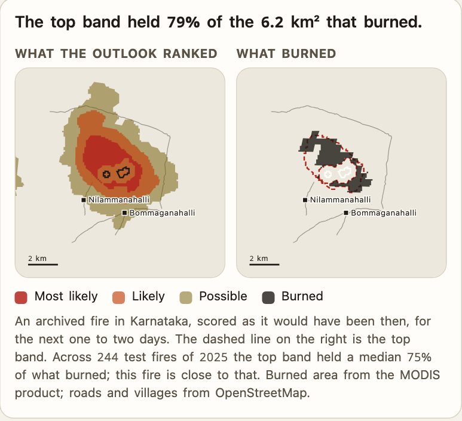
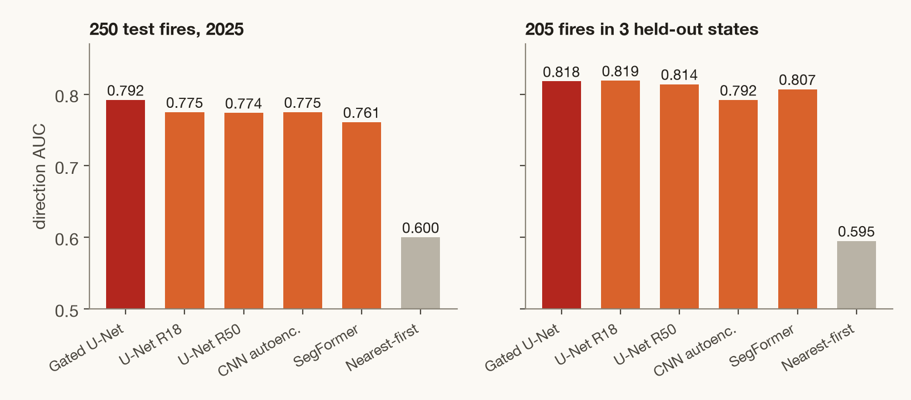
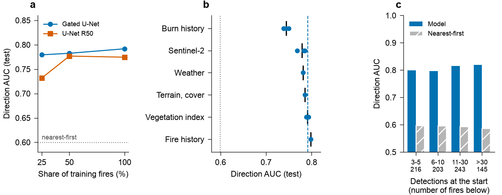
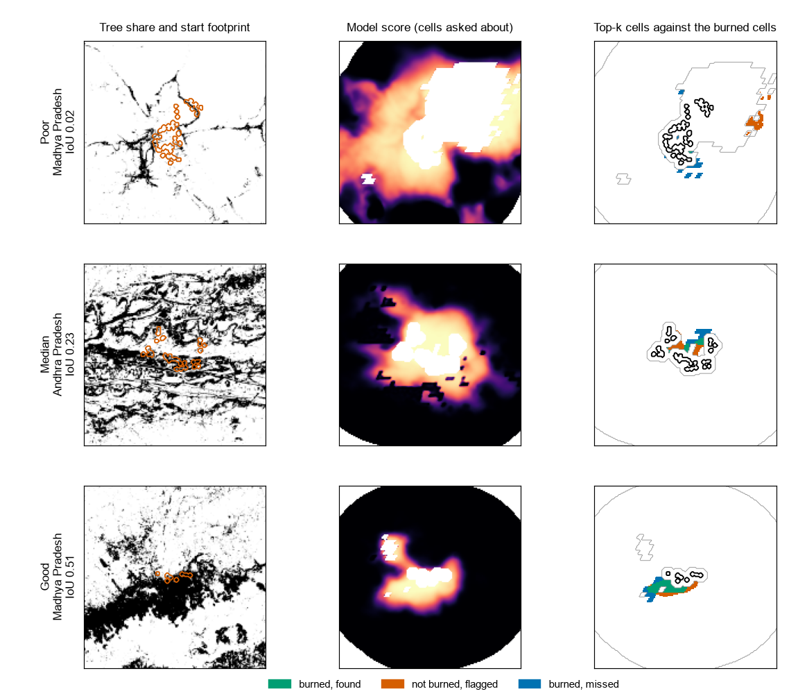
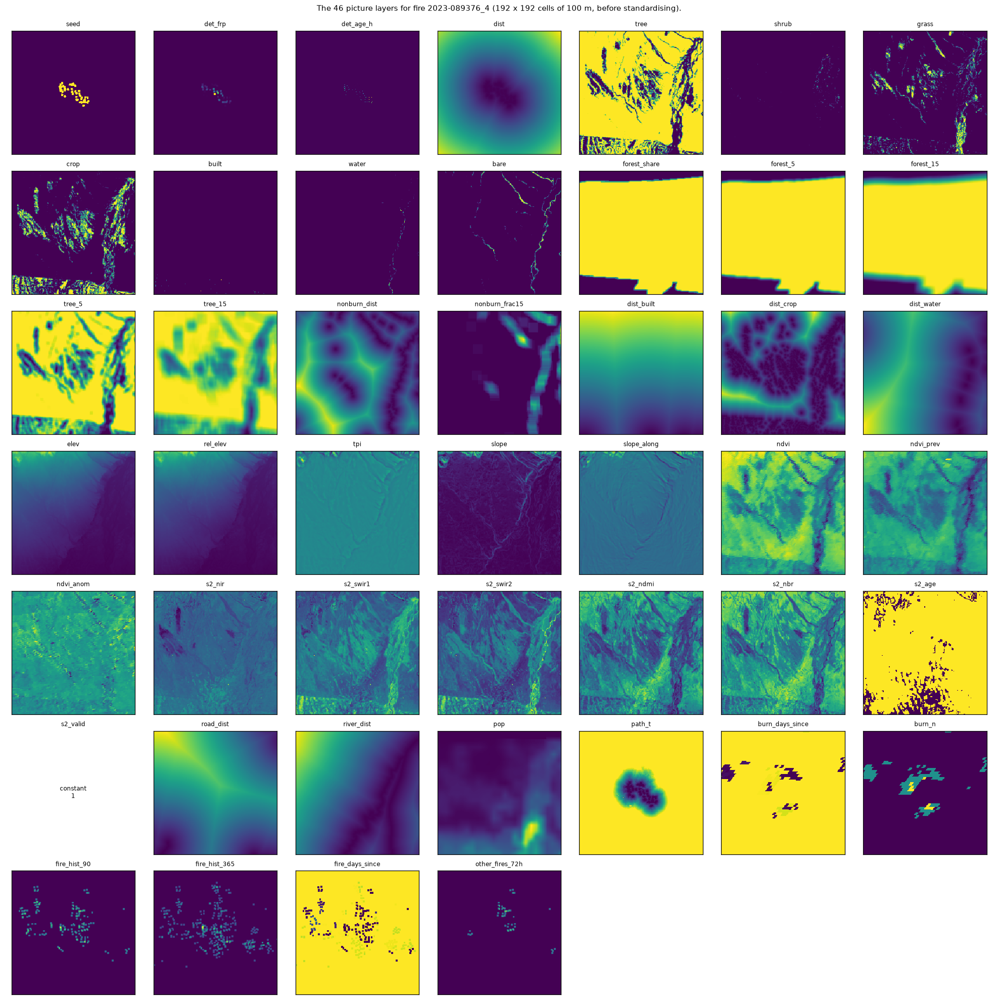
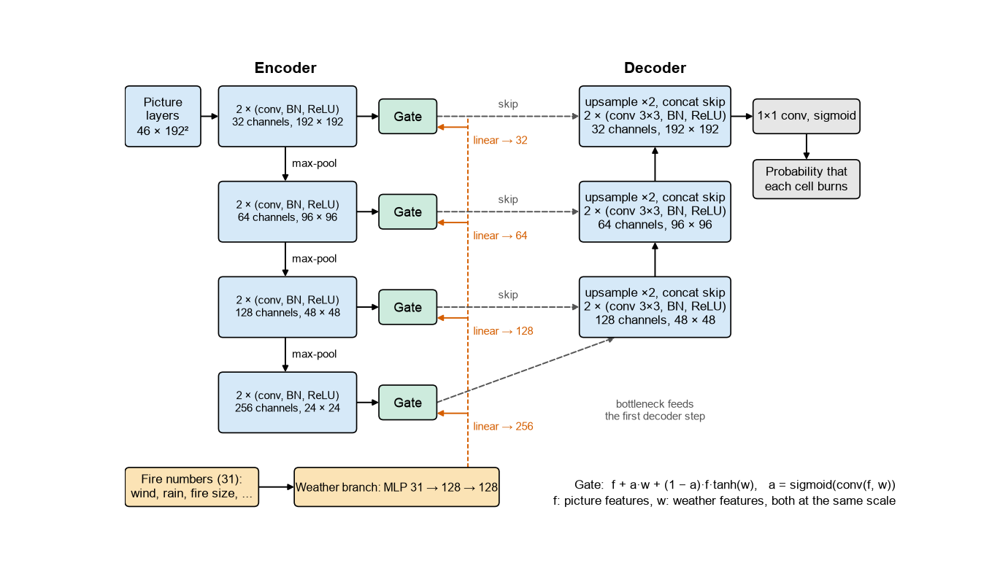

<div align="center">

# Fire spread outlook for India's forests

**A fire is burning. Which forest cells around it burn in the next one to two days?**<br>
2,930 real fires, 46 map layers each, five image models, and a check of every test fire against what the satellite later saw burned.

[Live site](https://terra-watch-tawny.vercel.app) &nbsp;·&nbsp; [Data card](docs/dataset.md) &nbsp;·&nbsp; [All results](docs/results.md) &nbsp;·&nbsp; [Sampling protocol](docs/sampling-protocol.md) &nbsp;·&nbsp; [Notebooks](notebooks/)




<sub>One archived fire in Karnataka, scored as it would have been at the time. Left: the three bands of the outlook. Right: what burned.</sub>

</div>

---

## Results

<table>
<tr>
<td width="58%" valign="top"></td>
<td width="42%" valign="top">

**Direction AUC** asks, among cells at about the same distance from the fire, whether the model ranks the ones that burned above the ones that did not. It measures what a model adds beyond "close to the fire burns".

| | Gated U-Net | Nearest-first |
|---|---|---|
| Direction AUC, test | **0.792** | 0.600 |
| Direction AUC, blind states | **0.818** | 0.595 |
| IoU at the true area, test | **0.227** | 0.113 |
| Average precision, test | **0.249** | 0.103 |

Mean of three seeds. Test: 250 fires of 2025 in blocks never trained on. Blind: 205 fires in three states held out completely.

</td>
</tr>
</table>

<div align="center">

</div>

- **a. More fires help little.** With a quarter of the training fires the gated U-Net is already at 0.78.
- **b. Burn history matters most.** Removing it costs the most; removing weather, terrain or the vegetation index costs little. Each dot is one seed.
- **c. It holds from small fires to large.** From 3 to 5 detections at the start up to more than 30, the model stays near 0.80 and nearest-first near 0.59.

**For the dashboard**, the scores are cut into three bands. Across 244 test fires a typical fire burned 1.9 km², and the top band (about 6.8 km²) covered a **median 75%** of it, against 50% for choosing the nearest cells first. The outlook did better than nearest-first in 70% of the fires and covered under 30% of the burn in 20%, mostly large fires.

<div align="center">
<br>
<sub>A poor, a median and a good test fire. Green: burned and found. Orange: flagged, not burned. Blue: burned and missed.</sub>
</div>

## What goes in

Each fire is a stack of **46 layers on a 192 × 192 grid of 100 m cells** (19.2 km across, centred on the fire) plus **31 numbers** (temperature, humidity and rain of the first day, rain and soil moisture before it, fire size, season and hour).

<div align="center">

</div>

| Group | Layers | Source |
|---|---|---|
| The fire | footprint, radiative power, detection age, distance to the fire, fuel-aware travel time, other fires in 72 h | NASA FIRMS VIIRS 375 m |
| Fuel and land | tree, shrub, grass, crop, built, water, bare; forest share; distance to what cannot burn | ESA WorldCover 10 m, forest boundaries |
| Terrain | elevation, relative elevation, position index, slope, slope along the path | Copernicus DEM 30 m |
| Vegetation state | NDVI, NDVI before, anomaly; Sentinel-2 NIR, SWIR, NDMI, NBR | MODIS MOD13Q1, Sentinel-2 |
| People | distance to roads and rivers, population | OpenStreetMap, WorldPop |
| History | days since the last burn, burn count, fire detections in 90 and 365 days | MODIS MCD64A1, FIRMS |

Walk through it for one fire in [`notebooks/01_raw_to_inputs.ipynb`](notebooks/01_raw_to_inputs.ipynb), and across fires in [`notebooks/02_inputs_across_fires.ipynb`](notebooks/02_inputs_across_fires.ipynb).

## The model

<div align="center">

</div>

A U-Net over the map layers, with a small branch for the 31 numbers that gates every skip connection, so the weather can strengthen or weaken what the map says at each scale. It was compared with U-Nets on ResNet-18 and ResNet-50 encoders, a CNN autoencoder, SegFormer, and the nearest-first baseline, three seeds each.

## The data set

| | |
|---|---|
| **Fires** | 2,930, from January 2019 to April 2025, in 25 states |
| **A case** | Two consecutive satellite looks at one forest fire. The forecast starts at the first. |
| **Label** | Cells that the MODIS burned-area product (500 m, dated to the day) shows burned within a day of the start, in patches touching this fire, 5 to 80 cells from it |
| **Splits** | By 1 × 1 degree block, never by single fires: train 1,900, validation 223, test 250, three blind states 205, the eight other states (a separate check) 352 |
| **Why "one to two days"** | The product dates burning only to the day. The cells burned within 24 h and within 48 h are identical in 45% of fires (median overlap 0.96), so the outlook is read as the next one to two days. |

Full description: [`docs/dataset.md`](docs/dataset.md). How the fires were chosen: [`docs/sampling-protocol.md`](docs/sampling-protocol.md). Where the files are: [terrawatch-datasets](https://github.com/Terra-Watch/terrawatch-datasets).

## Rules kept on purpose

- **A ranking, not a probability.** A cell not seen burning is not known to be unburnt: small fires are missed and cloud hides. Calibrated probabilities are not asked of this truth.
- **Where, not when.** The models cannot tell cells that burn on the second day from those that burn on the first, and the outlook gives no arrival time.
- **Uncertainty by block.** Neighbouring fires share weather and terrain, so intervals are bootstrapped over 1 × 1 degree blocks.
- **Two ways of looking.** Overall AUC is dominated by "close to the fire grows", so direction AUC inside distance bands is reported beside it.

## Layout

| Path | Content |
|---|---|
| `src/firespread/` | The library: config, viirs, forest, events, grid, rasters, weather, moisture, engine, cases, scoring, rank, imgmodels, live and more |
| `scripts/` | Numbered stages `02` to `65`, run in order: events, pilot, environment, evaluation, learned models, dataset export and audit, training, outlook. `scripts/cloud/` holds the cloud jobs |
| `tests/` | Unit tests: events, grid, weather, scoring, engine, dataset, live |
| `notebooks/` | The two explanatory notebooks, executed |
| `docs/` | `dataset.md`, `results.md`, `sampling-protocol.md`, `dashboard-plan.md`, `live-image-scoring-plan.md` and the other plans |
| `data/`, `release/` | Everything the scripts make (not tracked) |

## Run

Own environment in `.venv/` (numpy, pandas, scipy, rasterio, pyproj, shapely, numba, httpx, torch, pytest).

```bash
make check     # compile every file
make test      # unit tests
```

<details>
<summary><b>Order of work, from raw detections to cases</b></summary>

1. `02_events.py` builds fire events, observation epochs and forecast cases from the VIIRS files (about 7 minutes for 2019 to 2025).
2. `03_pilot.py` picks the pilot cases and freezes the dev/test split by 1 × 1 degree block.
3. `04_environment.py` writes one bundle per case: terrain, land cover, forest share, the start footprint, the truth in grid cells and hourly weather. Idempotent.
4. `05_qa.py` checks the bundles and writes `data/QA.md`.
5. `06_evaluate.py` runs the physical engine and the baselines and compares them. Dev cases may be used to tune; test cases only to report.
6. `54_export_dataset.py` to `60_boundary_audit.py` export and audit the released data set; `61_train.py` trains the image models.

Inputs are read in place from `terrawatch-datasets/` (FIRMS files, the forest mask, WorldCover tiles). The DEM is read per case from the public Copernicus bucket and weather from Open-Meteo.

</details>

<details>
<summary><b>Making the outlook the dashboard shows</b></summary>

The served outlook averages six gated U-Nets (three seeds on each of the two label horizons, which rank cells almost identically) into one ranking, cut into three bands within 8 km of the fire.

```bash
# every test fire against what burned -> data/65_outlook_check.csv
.venv/bin/python scripts/65_outlook_check.py --release release/fire_spread_dataset --models ../paper_fire_spread/results/models

# the chosen example fires -> a run folder for the dashboard
.venv/bin/python scripts/62_outlook_run.py --release release/fire_spread_dataset --models ../paper_fire_spread/results/models \
    --cases release/fire_spread_dataset/cases.csv --out ../website/backend/runtime_data/fire_spread --only CASE_ID,CASE_ID,...
```

`62` writes `events.json`, the bands, the burned area, places and roads, and `skill.json`. Copy the folder to `website/backend/app/fire_spread_data/` to ship it.

</details>

## Limits

- Live scoring is not built ([plan](docs/live-image-scoring-plan.md)); the dashboard shows archived 2025 fires.
- The label comes from a 500 m product. Only 68% of its burn dates fall within two days of an active-fire detection, and the date error was not measured for these fires.
- The model does not use wind: the wind numbers were dropped from the inputs, and removing the rest of the weather costs little.
- Fuel numbers of the physical engine are priors, not measurements. No Indian fuel model exists in this project.

---

<sub>Part of <a href="https://github.com/Terra-Watch">TerraWatch</a>: <a href="https://github.com/Terra-Watch/dashboard">dashboard</a> · <a href="https://github.com/Terra-Watch/wildfire-ignition-forecasting">forecast</a> · <a href="https://github.com/Terra-Watch/terrawatch-datasets">datasets</a> · <a href="https://github.com/Terra-Watch/acoustic-ml">sound classifier</a> · <a href="https://github.com/Terra-Watch/node-firmware">station firmware</a></sub>
